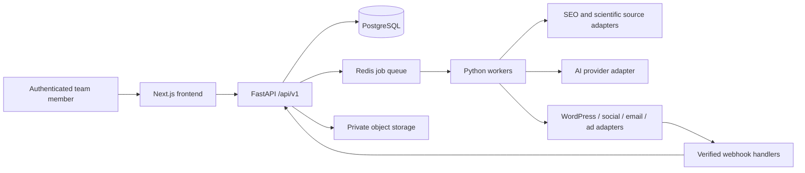

# Architecture: Reverse Age AI Growth Engine

## Scope and current state

Phase 1 implements an isolated frontend demonstration. The initial repository had no commits, refs, tracked files, manifests or instructions. No existing website was crawled, edited or deployed. The dashboard is static; mobile navigation is the only stateful interaction. It deliberately does not simulate successful connections or submissions.

The target is a modular marketing platform for busy professionals aged 35–60 across UAE, GCC and international markets. Use workspace isolation from the beginning, even if Reverse Age Coach is initially the only tenant. Audience locations and language preferences should be explicit settings, never inferred medical or sensitive traits.

## Target system

Start as a modular monolith with one API and worker deployment, not microservices. PostgreSQL is the system of record; Redis holds transient queues and rate-limit state. Use SQLAlchemy 2, Alembic migrations, Pydantic schemas and a Python 3.12+ runtime. Choose a maintained queue implementation in Phase 2 after verifying retry, cancellation and observability needs. Deploy the frontend, API and workers independently; use private connectivity for PostgreSQL, Redis and storage.

## Frontend boundaries

`app/page.tsx` renders demo data; `app/[workspace]/page.tsx` generates eight navigation previews. `components/shell.tsx` contains mobile interaction and active route state. `lib/workspaces.ts` provides typed navigation-page definitions. Add feature modules and an API client as live workflows arrive; do not import backend secrets into browser modules. Use generated OpenAPI types and server-side session handling for authenticated APIs. Provide explicit loading, empty, stale, permission-denied and failure states.

## Backend modules and contracts (proposed)

All routes below are future endpoints. Version them under `/api/v1`; derive tenant scope from authenticated membership, not a client-supplied workspace ID alone. Enforce pagination, request validation and structured errors. Every mutation records actor, timestamp and correlation ID.

| Module | Core responsibilities | Example routes |
| --- | --- | --- |
| Identity | OIDC sessions, memberships, role checks | `GET /me`, `GET /workspaces` |
| Search intelligence | Provider imports, intent classification, reproducible clustering | `POST /keyword-imports`, `GET /keyword-clusters` |
| Site intelligence | Read-only crawl jobs, competitor comparisons, gaps | `POST /audit-jobs`, `GET /audits/{id}` |
| Content | Briefs, versioned drafts, claim/source mappings, approvals | `POST /briefs`, `POST /drafts/{id}/reviews` |
| Social | English/Roman Urdu variants, review queues, timezone-aware scheduling | `POST /social-drafts`, `POST /scheduled-posts` |
| CRM | Consents, contacts, explainable scores, suppression | `POST /leads`, `POST /consents`, `POST /unsubscribes` |
| Email | Approved templates, sequences, delivery events | `POST /sequences`, `GET /delivery-events` |
| Advertising | Read-only reporting first, approved bounded mutations later | `GET /ad-accounts`, `GET /campaign-reports` |
| Analytics | Event ingestion, attribution, conversion aggregation | `POST /events`, `GET /reports/conversions` |
| Integrations | OAuth lifecycle, health, verified webhooks | `POST /integrations/{provider}/connect` |

Long tasks return `202` plus a job identifier. Jobs expose queued/running/completed/failed/cancelled status, bounded retries with backoff, failure details and idempotency keys. Apply per-provider throttling, duplicate detection and an outbox for reliable dispatch. A provider timeout after sending is reconciled before retrying to avoid duplicate messages or posts.

## PostgreSQL data model (proposed, no schema applied)

Use UUID primary keys, `created_at`/`updated_at` as `timestamptz`, and mandatory `workspace_id` on tenant-owned records. Foreign keys and compound constraints must prevent cross-workspace associations. Keep raw provider responses in restricted storage with retention limits rather than unlimited JSON blobs.

| Tables | Important attributes and relationships |
| --- | --- |
| workspaces, users, memberships | unique workspace/user membership; owner, editor, reviewer, analyst roles |
| integrations | provider, scopes, external account ID, connection state, encrypted token reference; no raw secrets in logs |
| keyword_imports, keywords, clusters, cluster_members | query, language, locale, source, observed_at; nullable volume/difficulty with units and provider; clustering version |
| audit_jobs, pages, audit_findings, competitors, content_gaps | crawl source/date, URL, severity, evidence, competitor snapshots and gap rationale |
| briefs, content_items, content_versions | locale, audience, version number, author, immutable version body, workflow state |
| scientific_sources, claims, claim_sources | DOI/PMID/URL, title, authors, publication date, retrieval date, evidence quality, retraction checks, verified reviewer/time |
| reviews, approvals | exact content version/hash, decision, actor, time, feedback; changes invalidate approvals |
| social_posts, schedules, publication_attempts | language, channel, approved version, UTC schedule, original IANA timezone, provider IDs, idempotency key |
| leads, consent_events, suppressions | minimal contact fields; purpose, channel, lawful source, policy version, grant/revoke timestamps; append-only consent history |
| lead_scores, score_rules | transparent rule version, explanation, input provenance; no sensitive health profiling |
| email_templates, sequences, enrollments, delivery_events | approved versions, subscription purpose, enrollment state, provider message IDs; unique event IDs |
| ad_accounts, campaigns, ad_daily_metrics | currency, timezone, provider, account/campaign IDs, observed_at, raw source and normalized metrics |
| analytics_events, conversions, attribution_results | pseudonymous IDs, event source/time, consent state, deduplication key, model/version/window |
| jobs, outbox_events, audit_events | execution state, attempts, idempotency, actor, redacted change history |

Add indexes on `(workspace_id, created_at)`, due schedules and provider event IDs. Store monetary values as numeric plus currency, never floating point. Unknown metrics remain null, never zero. Enforce tenant authorization in application services and PostgreSQL row-level security with transaction-scoped tenant context; test both with pooled connections. Soft deletion is not a substitute for erasure; retention jobs must remove personal data from active storage and expire backups under a documented policy.

## Evidence-based content workflow

Brief → draft → claims extraction → authoritative source retrieval → bibliographic/DOI resolution → claim-to-source support review → editorial/health review → exact-version approval → optional publication. A real DOI alone does not establish that a source supports a claim. Preserve excerpts and context where licensing permits, publication dates, evidence hierarchy, uncertainty and contradictions. Check retractions and human applicability. Never generate citations from model memory as verified references. Unsupported claims block approval. Avoid diagnosis, treatment promises or guaranteed age-reversal outcomes.

English and natural Roman Urdu variants share the same evidence and approval chain; human language review checks tone, transliteration and meaning. The model suggests drafts, never publishes or overrides consent. Treat imported pages, emails and references as untrusted input; separate them from system instructions, restrict tool access and validate structured outputs.

## Consent, approvals and security

Use an OIDC provider and secure HTTP-only same-site cookies with CSRF protection for mutations. Backend CORS allows specific frontend origins. Enforce server-side role and tenant checks on every route. Editors create drafts; reviewers approve; only authorized operators dispatch approved content. Approval is tied to a version and destination. Recheck consent, suppression and approval immediately before any send. Revocation stops pending jobs and sequence enrollment.

Encrypt tokens using a managed secret store/KMS; OAuth with state/PKCE, least scopes and rotation. Verify webhook signatures and freshness against the raw body; reject replays. Redact secrets and personal data from logs. Audit connection changes, approvals and outbound actions. Require separate confirmation, budgets and account limits for advertising mutations. Initial integrations are read-only wherever possible.

Crawlers require URL allowlists, SSRF defenses, DNS/IP revalidation, blocked private/link-local ranges, redirect checks, timeouts, size limits and robots/rate-limit policy. Uploads need content validation and private access. Perform jurisdiction-specific privacy review for UAE/GCC and international consent, transfer and retention rules before live lead ingestion. Do not claim legal compliance based on this design.

## Operations and quality

Structured logs with request/job IDs, error tracking, provider health and queue latency dashboards. Track token usage/cost, evidence review failures, delivery duplication and consent suppression. PostgreSQL backups require restore drills; migrations require staging and rollback planning. CI: frozen dependency install → lint → type check → unit/component tests → production build. Phase 2 adds PostgreSQL integration tests, tenant isolation tests, API contract tests and browser end-to-end checks. Provider sandboxes and signed webhook fixtures validate adapters before any production credentials are enabled.
